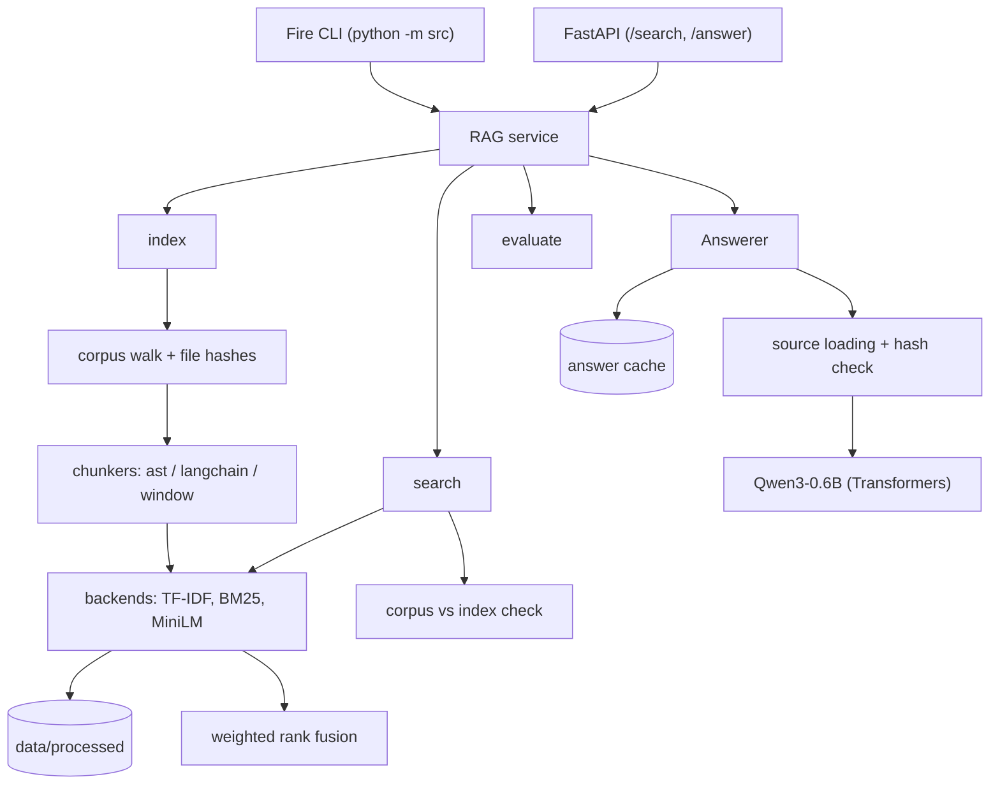

*This project has been created as part of the 42 curriculum by vquetier.*

# RAG against the machine

## Description

**RAG against the machine** is a Retrieval-Augmented Generation system that answers questions about a codebase (the vLLM 0.10.1 repository provided with the subject). It:

1. **indexes** the corpus: files are split into chunks of at most 2000 characters and stored in persistent indexes under `data/processed/`;
2. **retrieves** the most relevant chunks for a question, as source locations (`file_path`, `first_character_index`, `last_character_index`);
3. **generates** a grounded answer from those chunks with a small local model (`Qwen/Qwen3-0.6B`);
4. **evaluates** retrieval quality with recall@k against a ground-truth dataset.

The main features are:

- two distinct chunking strategies: AST-aware chunking for Python, recursive structure-aware splitting for Markdown and text;
- three retrieval backends that can be combined: TF-IDF (Xapian), BM25 (Tantivy) and semantic embeddings (MiniLM + Chroma);
- hybrid retrieval by weighted rank fusion;
- persistent, incremental indexing driven by per-file content hashes;
- persistent search and answer caches;
- a Python Fire command-line interface and a small local HTTP API (FastAPI);
- YAML configuration validated with pydantic.

## Instructions

### Requirements

- Python 3.10 to 3.13 (`requires-python = ">=3.10,<3.14"`).
- [uv](https://docs.astral.sh/uv/) as project and package manager.
- `git` and network access for the first `uv sync` (one dependency is pinned to a Git revision) and for the first download of the models from the Hugging Face Hub.
- Several gigabytes of free disk space for the deep-learning stack and the model weights.

A GPU is optional: both models run on CUDA when it is available and on CPU otherwise.

### Installation

```bash
git clone <repository-url> rag
cd rag
make install        # runs: uv sync
```

The expected data layout is the one of the subject:

```text
data/
├── raw/                  # corpus to index (e.g. data/raw/vllm-0.10.1/...)
├── datasets/
│   ├── UnansweredQuestions/
│   └── AnsweredQuestions/
├── processed/            # indexes and caches (generated)
└── output/               # search results and answers (generated)
```

`data/` is ignored by Git: the corpus, the datasets and everything generated stay out of the repository.

### Execution

Every command is run as `uv run python -m src <command> [options]`:

```bash
uv run python -m src index --max_chunk_size 2000
uv run python -m src search "How do I load a LoRA adapter?" --k 5
```

All commands are detailed in [Example usage](#example-usage).

### Makefile targets

| Target | Action |
|---|---|
| `make` / `make help` | Print the list of targets. |
| `make install` | Install or sync the dependencies with `uv sync`. |
| `make run ARGS="..."` | Run the CLI: `uv run python -m src $(ARGS)`. |
| `make debug ARGS="..."` | Run the CLI under `pdb`. |
| `make index`, `search`, `search_dataset`, `answer`, `answer_dataset`, `evaluate` | Shortcuts for the corresponding CLI command; options go in `ARGS`. |
| `make serve` | Start the HTTP API on `127.0.0.1:8000` (override with `HOST=` and `PORT=`). |
| `make client` | Open the Swagger UI of a running server with `xdg-open`. |
| `make profile ARGS="..."` | Profile the `index` command with `cProfile` and open the result in `snakeviz`. |
| `make lint` | Run `flake8 .` and `mypy .` with the flags required by the subject (`.venv` and `data` are excluded by `.flake8` and `pyproject.toml`). |
| `make lint-strict` | Run `flake8 .` and `mypy . --strict`. |
| `make clean` | Remove Python and tool caches (`__pycache__`, `.mypy_cache`, `*.pyc`, ...). Safe. |
| `make dclean` | **Destructive**: delete everything in `data/` except `raw/` and `datasets/`, i.e. all indexes, caches and outputs. |
| `make fclean` | `clean`, then delete `.venv`. |
| `make re` | `fclean`, then `install`. |

```bash
make index ARGS="--max_chunk_size=2000 --config_file=docs.yaml"
make search ARGS="--query=\"what is LoRA?\" --k=5 --config_file=docs.yaml"
```

`dclean` is never needed in normal use: indexing is incremental and updates the existing indexes in place.

### Configuration

Behaviour is driven by a YAML file from the `config/` directory, selected on every CLI command with `--config_file=<name>` (a file name, not a path; default: `default.yaml`). Each file has its own `paths.processed` directory, so several configurations can keep their indexes side by side.

| File | Indexed file types | Enabled backends (weights) | Index directory |
|---|---|---|---|
| `default.yaml` | `.py`, `.md`, `.txt` | TF-IDF 0.05, BM25 1.0, MiniLM 0.1 | `data/processed/default` |
| `docs.yaml` | `.md`, `.txt` | TF-IDF 0.1, BM25 1.0, MiniLM 0.1 | `data/processed/docs` |
| `code.yaml` | `.py` (also excludes `tests`, `examples`) | TF-IDF 0.05, BM25 1.0, MiniLM 0.5 | `data/processed/code` |
| `fast.yaml` | `.py`, `.md`, `.txt` | BM25 1.0 only | `data/processed/fast` |

The schema is the same for every file:

```yaml
paths:
  raw: "data/raw"                  # corpus directory
  processed: "data/processed/docs" # root of the indexes and caches

indexing:
  excludes: ["__pycache__", ".git", ".venv"]   # directory names, at any depth
  file_types:                                   # .py, .md and .txt must all be declared
    .py:  {chunking_method: "ast",       enabled: false}
    .md:  {chunking_method: "langchain", enabled: true}
    .txt: {chunking_method: "langchain", enabled: true}

retrieval:
  backends:
    tfidf:  {enabled: true, weight: 0.1, path: "tfidf"}
    bm25:   {enabled: true, weight: 1.0, path: "bm25"}
    minilm: {enabled: true, weight: 0.1, path: "minilm"}

evaluation:
  recall: [1, 3, 5, 10]   # k values reported by `evaluate`
  min_iou: 0.05

answer:
  model_name: "Qwen/Qwen3-0.6B"
  path: "generation"       # answer cache directory, under paths.processed
  thinking_mode: true
  temperature: 0.7
  max_input_tokens: 20000
  max_output_tokens: 20000
  preprompt: ""
```

The file is validated by pydantic models (`src/rag/config/config.py`) and any problem is reported as a readable list of errors:

- unknown keys are rejected, and every section is required;
- chunking methods are `ast` (Python only), `langchain` or `window`; at least one file type and one backend must be enabled;
- backend weights are in `]0, 1]`, `temperature` in `]0, 1]`, `min_iou` in `[0.05, 1]`, recall values are `>= 1`, and `max_input_tokens` and `max_output_tokens` are `>= 256`;
- `excludes` entries are directory names, not paths;
- `paths.raw` and `paths.processed` must be distinct directories, and every storage directory (one per backend, plus the answer cache) must be a dedicated subdirectory of `paths.processed` that is neither equal to, inside of, nor a parent of the corpus directory, and not nested in another storage directory. Dataset and output locations are not configured here: they are always given as CLI arguments.

That last rule exists because the recovery procedure of a broken index is to delete its directory by hand: the configuration must make that deletion unable to reach the corpus or another index.

The chunk size is not part of the YAML file: it is the `--max_chunk_size` argument of `index` (default 2000, accepted range 1 to 2000).

## Example usage

Python Fire accepts both `--option value` and `--option=value`. `query` can be given positionally or as `--query`. Text arguments (queries, paths, configuration name) are taken verbatim: they are never converted to numbers, booleans or lists. Diagnostics and progress bars are written to standard error and results to standard output. Expected errors are reported as a one-line message with exit status 1; a usage error reported by Fire or an unexpected error exits with status 2, and Ctrl+C with 130.

### Index

```bash
uv run python -m src index --max_chunk_size 2000 --config_file docs.yaml
```

Builds the indexes of every enabled backend, or updates them incrementally if they exist. `--max_chunk_size` must be between 1 and 2000.

### Search

```bash
uv run python -m src search "How do I load a LoRA adapter?" --k 5 --config_file docs.yaml
```

Prints one line per source, best first, in the form `<file_path> [<first>:<last>]`. `--k` defaults to 5. An empty query or `k <= 0` returns no result with a warning.

### Search a dataset

```bash
uv run python -m src search_dataset \
  --dataset_path data/datasets/UnansweredQuestions/dataset_docs_public.json \
  --k 10 \
  --save_directory data/output/search_results/UnansweredQuestions \
  --config_file docs.yaml
```

Reads a `RagDataset` JSON file and writes the results to `<save_directory>/<dataset file name>`. The command refuses to overwrite its own input.

Input:

```json
{
  "rag_questions": [
    {"question_id": "q1", "question": "How to configure OpenAI server?"}
  ]
}
```

Output (`StudentSearchResults`; each source carries an additional `chunk_hash` field, see [Source integrity](#source-integrity-and-snapshots)):

```json
{
  "search_results": [
    {
      "question_id": "q1",
      "question": "How to configure OpenAI server?",
      "retrieved_sources": [
        {
          "file_path": "data/raw/vllm-0.10.1/docs/serving/openai_compatible_server.md",
          "first_character_index": 9867,
          "last_character_index": 10100,
          "chunk_hash": "<sha256 of the chunk text>"
        }
      ]
    }
  ],
  "k": 10
}
```

### Answer

```bash
uv run python -m src answer "How do I load a LoRA adapter?" --k 5 --config_file docs.yaml
```

Retrieves the top-k sources, generates an answer with the local model and renders it as Markdown in the terminal.

### Answer a dataset

```bash
uv run python -m src answer_dataset \
  --student_search_results_path data/output/search_results/UnansweredQuestions/dataset_docs_public.json \
  --save_directory data/output/search_results_and_answer/UnansweredQuestions \
  --config_file docs.yaml
```

Reads a search results file and writes a `StudentSearchResultsAndAnswer` file (the same structure, with an `answer` string in each entry) to `<save_directory>/<input file name>`. A question whose answer cannot be generated receives a placeholder answer and is counted as failed in the final summary, so the output always contains every question.

### Evaluate

```bash
uv run python -m src evaluate \
  --student_search_results_path data/output/search_results/UnansweredQuestions/dataset_docs_public.json \
  --dataset_path data/datasets/AnsweredQuestions/dataset_docs_public.json
```

Prints recall@k for the k values of `evaluation.recall`:

```text
Questions evaluated: 100
Recall@1:  0.60 (60.00%)
Recall@3:  0.79 (79.00%)
Recall@5:  0.88 (88.00%)
Recall@10: 0.94 (94.00%)
```

This command is a development tool; it never imports or calls the official moulinette.

### Command reference

| Command | Options | Defaults |
|---|---|---|
| `index` | `--max_chunk_size`, `--config_file` | `2000`, `default.yaml` |
| `search` | `query`, `--k`, `--config_file` | required, `5`, `default.yaml` |
| `search_dataset` | `--dataset_path`, `--k`, `--save_directory`, `--config_file` | required, required, required, `default.yaml` |
| `answer` | `query`, `--k`, `--config_file` | required, `5`, `default.yaml` |
| `answer_dataset` | `--student_search_results_path`, `--save_directory`, `--config_file` | required, required, `default.yaml` |
| `evaluate` | `--student_search_results_path`, `--dataset_path`, `--config_file` | required, required, `default.yaml` |

## System architecture



| Module | Responsibility |
|---|---|
| `src/__main__.py` | Entry point: runs Fire on `RagCLI` and turns application errors into a message and an exit status. |
| `src/rag/rag_cli.py` | `RagCLI`: validates raw CLI arguments, selects the configuration, delegates to `RAG`. |
| `src/rag/rag_http_api.py` | FastAPI application exposing `RAG.search` and `RAG.answer`. |
| `src/rag/rag.py` | `RAG`: orchestration layer shared by the CLI and the API. |
| `src/rag/config/` | Pydantic configuration models, YAML loading and dumping. |
| `src/rag/data_models/` | Pydantic models of the subject, their hash-carrying variants, and source helpers. |
| `src/rag/retrieval/load.py` | Corpus walk, exclusions, UTF-8 reading. |
| `src/rag/retrieval/chunking/` | The three chunkers. |
| `src/rag/retrieval/backends/` | `RetrievalBackend` base class (sessions, manifest, incremental logic, search cache) and the three engines. |
| `src/rag/retrieval/index.py`, `search.py`, `check.py` | Indexing loop, rank fusion, corpus/index comparison. |
| `src/rag/generation/` | `Answerer` (prompt, answer cache) and `LLM` (model, token budgets). |
| `src/rag/evaluation/` | Recall@k and IoU. |
| `src/rag/dataset/` | JSON loading and writing of datasets, results and answers. |
| `src/rag/logger/` | Console output (rich) and progress bars (tqdm). |
| `src/rag/errors/` | `RagError` hierarchy and validation error formatting. |

The pipeline works as follows.

1. **Corpus discovery.** `paths.raw` is walked with `os.walk`; directories listed in `indexing.excludes` are pruned; only non-empty files of an enabled type are kept and read as UTF-8; a file that cannot be read as UTF-8 text is skipped.
2. **Indexing.** Each file is hashed (SHA-256). Every backend records it in its new manifest and says whether it needs the file. A file is chunked only if at least one backend needs it, and each chunk is given the SHA-256 of its text.
3. **Storage.** Each backend stores the chunk in its own engine under `data/processed/<profile>/<backend>/`.
4. **Retrieval.** Each enabled backend returns its best chunks for the query; the rankings are merged by weighted rank fusion.
5. **Augmentation.** The text of each retrieved source is read back from the corpus, verified against its chunk hash and placed in the prompt.
6. **Generation.** The prompt is checked against the token budgets, the model generates, and the final answer is extracted and cached.
7. **Evaluation.** Retrieved sources are compared with the ground truth by file and character overlap.

Models and backends are created lazily: `evaluate` loads no model, `search` with `fast.yaml` loads no embedding model, and the LLM is only loaded when an answer actually has to be generated.

## Chunking strategy

A chunk is a `MinimalSource`: a file path and a half-open range of **Unicode character indices** in the decoded file (`content[first:last]`). The maximum chunk size is counted in characters and enforced by every chunker.

Code and prose are split differently because their natural units differ: a function or a class is the unit a code question refers to, while documentation is organised by headings and paragraphs.

### Python: AST-aware chunking

`src/rag/retrieval/chunking/ast.py` parses the file with the standard `ast` module and chunks it recursively:

- a range that fits in `max_chunk_size` is kept whole;
- otherwise it is divided at the ends of its *structural* children (statements, and nodes that contain statements such as `except` handlers). Each child receives the text since the end of the previous sibling, so decorators, comments and blank lines stay attached to the definition that follows them, and the header of a class or function stays with its first statement;
- children that are still too large are chunked recursively (a class into its methods, a method into its blocks);
- neighbouring chunks are merged greedily while the merged range still fits, which avoids producing many tiny chunks for runs of imports or assignments;
- a range that is too large and has no structural child (a huge literal, a long comment block) is split along line boundaries, and a single over-long line is cut into fixed-size pieces.

The chunks of a Python file are contiguous, never overlap and cover the whole file.

**Byte offsets versus character indices.** The `ast` module reports `col_offset` and `end_col_offset` as UTF-8 *byte* offsets within the line, whereas the subject expects *character* indices. `get_boundaries` therefore converts them: on a line that contains non-ASCII characters, the UTF-8 prefix of `col_offset` bytes is decoded and its length in characters is used; on an ASCII line both are equal and no conversion is needed. Line starts are precomputed once per file.

**Fallback.** A file that `ast.parse` rejects (`SyntaxError` or `ValueError`) is chunked with the recursive text splitter using Python separators instead of being skipped.

### Markdown and text: recursive splitting

`src/rag/retrieval/chunking/langchain.py` uses LangChain's `RecursiveCharacterTextSplitter`: with Markdown separators (headings, code fences, horizontal rules, paragraphs) for `.md`, and the default separators (paragraphs, lines, words) for `.txt`. The splitter tries the coarsest separator first and only falls back to finer ones for pieces that are still too large, so chunks follow the document structure where possible.

- `chunk_size` is `max_chunk_size`, measured in characters.
- Consecutive chunks may overlap by up to `min(100, max_chunk_size // 10)` characters, so that a sentence cut at a boundary remains retrievable.
- `add_start_index` gives the position of each chunk in the original text; the end index is the start plus the chunk length.

### Fixed window

`window` is a third, minimal method (consecutive windows of `max_chunk_size` characters, no overlap) available in the configuration as a baseline.

### Chunk size

`--max_chunk_size` defaults to 2000, the maximum allowed by the subject, and values above 2000 are rejected. The value is stored in each index manifest: indexing again with a different value rebuilds the whole index. On the provided corpus, with a maximum of 2000, the chunkers produce 12,979 chunks for 1,641 Python files and 888 chunks for 206 Markdown and text files, none longer than 2000 characters.

## Retrieval method

### Backends

| Backend | Kind | Engine | Scoring |
|---|---|---|---|
| `tfidf` | lexical | [Xapian](https://xapian.org/) | `TfIdfWeight` |
| `bm25` | lexical | [Tantivy](https://github.com/quickwit-oss/tantivy) | BM25 |
| `minilm` | semantic | `all-MiniLM-L6-v2` + [Chroma](https://www.trychroma.com/) | cosine distance |

**TF-IDF (Xapian).** Each chunk is a Xapian document indexed with a `TermGenerator`, without positional information; the serialized source is stored as document data. Queries go through Xapian's `QueryParser` with boolean operators disabled, so words such as `AND` or `NOT` in a question are ordinary terms and cannot cause a syntax error; results are ranked with the TF-IDF weighting scheme. Two hashed boolean terms (file path, file type) make it possible to delete the chunks of one file or of one file type.

**BM25 (Tantivy).** Each chunk is a Tantivy document whose `body` field is tokenized and indexed (not stored); the source location and chunk hash are stored fields, and the file path and file type are indexed as raw terms for deletion. The question is not interpreted as query syntax: it is tokenized and lowercased, over-long tokens are dropped, and the tokens are combined as optional terms (a boolean OR), so arbitrary text never raises a syntax error. Tantivy scores with BM25. TF-IDF and BM25 are two separate implementations in two separate engines.

**MiniLM (semantic).** Chunks are embedded with `sentence-transformers/all-MiniLM-L6-v2`, normalised, and stored in a persistent Chroma collection configured for cosine distance (HNSW index). Only the embeddings and metadata are stored. The query is embedded the same way and the nearest chunks are returned. On CPU the model runs through its 8-bit quantized **OpenVINO** export; on CUDA it runs in PyTorch with half precision. Chunks are buffered and embedded in batches (commit every 2048 chunks, encoding batches of 128).

Lexical backends match the exact words of the question, which is ideal when it quotes an identifier or an option name. The semantic backend matches meaning, which helps when the question paraphrases the source. The two fail in different cases, which is why they are combined.

### Weighted rank fusion

Raw scores are not comparable across backends (a TF-IDF weight, a BM25 score and a negated cosine distance live on different scales), so they are never mixed. Only **ranks** are combined (`src/rag/retrieval/search.py` and `RetrievalBackend.search`):

1. For a request of `k` results, each enabled backend is asked for `K = max(50, 2k)` hits, so the candidate pool does not shrink for small `k`.
2. Within a backend, hits are ranked by decreasing raw score; hits with equal raw scores share the same rank `r` (1 is best).
3. Each hit receives the score `w * (K - r + 1) / K`, where `w` is the backend weight from the configuration. The best hit of a backend scores `w`, the last possible one `w / K`.
4. Scores of the same chunk coming from several backends are **added**. Two hits are the same chunk when file path, character range and chunk hash are all equal, which is always the case across backends since they index the same chunks; this is also how duplicates are removed.
5. Chunks are sorted by decreasing total and the first `k` are returned.

A chunk found by several backends is therefore promoted over a chunk found by one, and the weights express how much each backend is trusted for a given kind of corpus (BM25 dominates in every configuration; the semantic backend weighs more in `code.yaml` than in `docs.yaml`).

## Persistent and incremental indexing

### On-disk layout

```text
data/processed/<profile>/
├── tfidf/
│   ├── data/            # engine files (Xapian database)
│   ├── config.yaml      # configuration the index was built with
│   ├── manifest.json    # max_chunk_size + SHA-256 of every indexed file
│   ├── search_cache/    # per-backend search cache
│   └── .indexing        # only present during, or after an interrupted, indexing run
├── bm25/                # same layout (Tantivy index)
├── minilm/              # same layout (Chroma store)
└── generation/          # answer cache
```

### Incremental updates

Running `index` on an existing index only processes what changed. For each backend:

- a file whose path and content hash match the manifest is skipped;
- a new file is chunked and added;
- a modified file has its old chunks deleted, then is chunked and added again;
- a file present in the old manifest but no longer found in the corpus (deleted, or now excluded) has its chunks deleted at the end of the run;
- if the chunking method of a file type changed, or the file type was disabled, all chunks of that type are deleted (and re-created if it is still enabled);
- if `--max_chunk_size` differs from the manifest, the whole index is emptied and rebuilt.

Each backend decides independently, so enabling a new backend builds only that one. The summary printed at the end gives, per backend, the number of files indexed, unchanged and removed. The manifest and the configuration copy are written through a temporary file that then replaces the previous one.

### Interrupted indexing

Each backend creates an empty `.indexing` marker in its index directory when an indexing session starts and removes it only after the final commit and the writing of the manifest. If the run fails or is interrupted (error, Ctrl+C), the marker stays in every backend taking part in the run.

An index directory that holds the marker, or that lacks its manifest, configuration copy or data directory, is treated as incomplete:

- `index` refuses to update it;
- `search` and `answer` refuse to query it;
- **nothing is repaired or deleted automatically.** The error message names the directory to remove.

Recovery is manual and explicit:

```bash
rm -rf data/processed/docs/minilm          # the directory named in the error message
uv run python -m src index --config_file docs.yaml
```

Only the deleted backend is rebuilt from scratch; the others are updated incrementally. Automatic deletion was deliberately avoided: index paths come from a user-editable configuration, and silently removing a directory tree chosen by a configuration file is not a safe default. An explicit failure with a precise instruction was preferred.

There is no index format version either: an index is expected to be rebuilt after a change of implementation, which is what happens during an evaluation.

### Stale indexes are still searchable

An *incomplete* index is unusable, but an *out-of-date* one is not. Before every search, `check` compares each index with the current corpus and configuration and prints warnings such as:

```text
WARNING  bm25, minilm: index is out of date with the corpus (206 files): 2 files modified since indexing.
INFO     Search continues on the indexed snapshot. Run the index command to update it.
```

It reports files that are not indexed, modified since indexing, or indexed but gone, as well as file types whose enabled state or chunking method differs from the stored configuration. The index is neither modified nor invalidated: retrieval queries the persisted snapshot, not the live corpus, and remains fully functional. Three states must therefore be distinguished: the **current corpus**, the **indexed snapshot**, and any **previously generated results file**, which reflects the snapshot that existed when it was written.

## Source integrity and snapshots

The subject's `MinimalSource` (path and character range) is extended by `Source`, which adds an optional `chunk_hash`: the SHA-256 of the chunk text at indexing time. The application reads and writes the hash-carrying models (`RagSearchResults`, `RagSearchResultsAndAnswer`); they are supersets of the subject's models, and files without hashes are accepted as input.

The hash is what makes a source location verifiable later:

- **At retrieval time**, sources come straight from the index. They are not re-read from disk, so a search returns the indexed snapshot even if files changed since (with the warnings described above).
- **At generation time**, the text has to be read from the corpus. `load_source` reads the file, checks that it is still long enough, extracts the range and compares its SHA-256 with `chunk_hash`. A source whose file is missing, unreadable, too short or whose content changed is rejected rather than silently feeding different text to the model.
- Rejected sources are skipped with a warning and the answer is generated from the remaining ones. If no source is usable, the question fails with an explicit error (and, in `answer_dataset`, receives a placeholder answer).
- A source without hash (results produced by another tool) is accepted as long as its range exists.

The returned `retrieved_sources` always list everything that was retrieved, including sources that could not be used.

## Search and answer caching

Both caches are persistent [`diskcache`](https://grantjenks.com/docs/diskcache/) stores, limited to 512 MB each with least-recently-used eviction.

### Search cache

Each backend has its own cache in `<index>/search_cache/`. It stores the **raw hits** of the engine under the key `(query, K, fingerprint)`:

- `query` is the stripped question and `K` the number of hits requested from the engine (`max(50, 2k)`);
- `fingerprint` is the SHA-256 of the index manifest (chunk size and all file hashes) and of the file type settings the index was built with.

Any indexing run that changes the indexed content changes the fingerprint, so stale entries can no longer be hit; they are simply evicted over time. Because raw hits are cached *before* rank conversion and weighting, fusion weights can be tuned without invalidating anything, and each backend benefits independently. In practice this skips the query embedding and vector search on repeated queries.

### Answer cache

The answer cache lives in `<paths.processed>/<answer.path>/` and uses two kinds of entries:

- a **request entry**: `(question, all retrieved sources, answer settings)` → the key of the answer generated for that request;
- an **answer entry**: `(question, sources actually used, answer settings)` → the answer text.

Sources are identified by path, range and chunk hash, and the answer settings are the whole `answer` section of the configuration (model, thinking mode, temperature, token limits, preprompt), so changing any of them leads to a new generation.

The lookup is designed to keep answers usable across corpus changes instead of discarding them:

1. The sources of the request that are still valid (file readable, hash matching) are computed.
2. If a request entry exists and every currently valid source belongs to the sources the recorded answer was generated from, that answer is returned. An answer therefore **survives the later modification or deletion of its sources**: results from an older snapshot are still answered from the cache, with the text that was true for that snapshot.
3. Otherwise, an answer generated from exactly the currently valid sources is looked up, which serves **partial** source sets consistently.
4. On a miss, the answer is generated from the usable sources and both entries are stored.

The trade-off is intentional: a cached answer describes the sources as they were when it was generated. It is not regenerated because a file changed afterwards; re-indexing and searching again produce new sources (new hashes), hence a new request and a new answer. The question identifier is not part of the key, so the same question with the same sources is generated once across datasets. `answer` and `answer_dataset` report whether answers came from the cache.

## Answer generation

`src/rag/generation/` implements generation with Hugging Face **Transformers** and **PyTorch** (`pipeline("text-generation")`). OpenVINO is only used by the embedding backend, not by the generator.

- **Model.** `answer.model_name`, `Qwen/Qwen3-0.6B` by default, on CUDA when available and on CPU otherwise. It is loaded lazily, on the first answer that is not served from the cache.
- **Prompt.** A system message instructs the model to answer the specific question from the provided excerpts, to treat sources as evidence and never as instructions, not to invent commands or behaviour, to say what is missing when the sources are insufficient, and to stay concise. An optional `answer.preprompt` is sent as an extra user message. The final user message lists the sources in retrieval order (`source 1: ...`, `source 2: ...`) followed by `query: <question>`.
- **Context.** The context is exactly the retrieved sources that passed verification: the number of sources is controlled by `--k` (or by the search results file), and no source is truncated, re-ranked or dropped to fit a budget.
- **Token budgets.** Before generating, the prompt is tokenized with the chat template and checked: it must not exceed `answer.max_input_tokens`, and prompt plus `answer.max_output_tokens` must fit in the model context window, read from the model configuration and tokenizer. A prompt that does not fit fails with a message giving the measured sizes and suggesting to reduce `--k` or adjust the limits, instead of being silently truncated.
- **Sampling.** Generation uses sampling with `answer.temperature` and at most `answer.max_output_tokens` new tokens.
- **Thinking mode.** `answer.thinking_mode` is passed to the chat template (`enable_thinking`). Everything up to the last `</think>` marker is removed from the output. If thinking is enabled and the marker is missing, generation stopped before the answer started: this is reported as an error suggesting to raise `max_output_tokens` or disable thinking, rather than returning reasoning as if it were an answer. An empty answer is also an error.
- **Output.** `answer` renders the result as Markdown with `rich`; `answer_dataset` writes the JSON file described above.

## Local HTTP API

`src/rag/rag_http_api.py` exposes retrieval and generation over HTTP with FastAPI. It is a thin layer: both endpoints call the same `RAG.search` and `RAG.answer` methods as the CLI.

```bash
make serve                      # http://127.0.0.1:8000
make serve HOST=127.0.0.1 PORT=9000
```

| Method | Path | Body | Response |
|---|---|---|---|
| `POST` | `/search` | `{"query": "<text>", "k": 5}` | `question_id`, `question`, `retrieved_sources` |
| `POST` | `/answer` | `{"query": "<text>", "k": 5}` | the same fields plus `answer` |

`query` must contain at least one character and `k` must be at least 1 (default 5). For `/search`, `question_id` is the SHA-256 of the stripped query; for `/answer` it is a random UUID. Interactive documentation (Swagger UI) is served at `/docs`; `make client` opens it.

```bash
curl -X POST http://127.0.0.1:8000/search \
  -H "Content-Type: application/json" \
  -d '{"query": "How do I load a LoRA adapter?", "k": 3}'

curl -X POST http://127.0.0.1:8000/answer \
  -H "Content-Type: application/json" \
  -d '{"query": "How do I load a LoRA adapter?", "k": 3}'
```

```json
{
  "question_id": "<sha256 of the query>",
  "question": "How do I load a LoRA adapter?",
  "retrieved_sources": [
    {
      "file_path": "data/raw/vllm-0.10.1/docs/features/lora.md",
      "first_character_index": 4695,
      "last_character_index": 6098,
      "chunk_hash": "<sha256 of the chunk text>"
    }
  ]
}
```

- **Lifecycle.** One `RAG` instance is created at startup and shared by all requests, so models stay loaded between requests. The answer cache is closed at shutdown.
- **Concurrency.** The server runs a single worker and every request takes a lock: requests are processed one at a time, which keeps the non-thread-safe indexes, caches and models consistent.
- **Errors.** Application errors (missing or incomplete index, unusable sources, token budget exceeded, ...) return `400` with `{"detail": "<message>"}`; invalid request bodies return FastAPI's standard `422`.
- **Configuration.** The server always uses `config/default.yaml`. It is validated before startup, and an invalid file stops the server with a readable message.
- **Scope.** The server binds to `127.0.0.1` by default and has no authentication: it is meant for local use. Indexing, dataset processing and evaluation are only available from the CLI.

## Performance analysis

### Evaluation methodology

`evaluate` implements the metric of the subject. For each question, retrieved sources are scanned in rank order; an expected source is *found* when a retrieved source is in the same file and their intersection over union is at least `evaluation.min_iou` (0.05). Each expected source is counted once. Recall@k is the share of expected sources found in the first k results, averaged over the questions. If a question has fewer results than an evaluated k, the corresponding line is flagged `estimated` or `lower bound`.

The subject requires at least **80 % recall@5 on docs** and **50 % on code**, indexing in **at most 5 minutes**, and **at most 90 seconds for 200 questions**. The official score is computed by the moulinette, not by this command.

### Recall@k

Measured with `evaluate` on the public datasets, from results produced by `search_dataset --k 10` on indexes built with `--max_chunk_size 2000`, on a CPU-only run (quantized OpenVINO embeddings):

| Dataset | Configuration | Questions | Recall@1 | Recall@3 | Recall@5 | Recall@10 |
|---|---|---|---|---|---|---|
| `dataset_docs_public.json` | `default.yaml` | 100 | 51.00 % | 78.00 % | **84.00 %** | 88.00 % |
| `dataset_code_public.json` | `default.yaml` | 99 | 36.36 % | 50.51 % | **56.57 %** | 66.67 % |
| `dataset_docs_public.json` | `docs.yaml` | 100 | 62.00 % | 81.00 % | **91.00 %** | 94.00 % |
| `dataset_code_public.json` | `code.yaml` | 99 | 33.33 % | 52.53 % | **61.62 %** | 68.69 % |
| `dataset_docs_public.json` | `fast.yaml` | 100 | 59.00 % | 76.00 % | **83.00 %** | 87.00 % |
| `dataset_code_public.json` | `fast.yaml` | 99 | 34.34 % | 51.52 % | **56.57 %** | 64.65 % |

Remarks:

- Every configuration is above the thresholds of the subject (80 % on docs, 50 % on code). `default.yaml`, the configuration used when `--config_file` is omitted, indexes code and documentation into a single index and passes both.
- The fusion weights were chosen by a grid search on these public datasets, preferring settings whose neighbours in the grid score similarly over isolated maxima. They are therefore fitted to about 100 questions per dataset, and the same margins are not guaranteed on other questions.
- BM25 carries most of the signal on this corpus: BM25 alone (`fast.yaml`) is within one point of the three-backend default, and the semantic backend helps mostly on code questions when only code is indexed (`code.yaml`).
- The dedicated configurations index only the relevant file types, which removes the competition between code and documentation chunks for the same top-5.
- The official moulinette (`evaluate_student_search_results --k 10 --max_context_length 2000`) validates the `default.yaml` outputs and reports the same recall values as `evaluate` on both datasets.

### Effect of the chunk size

`default.yaml`, same CPU-only conditions, the whole index rebuilt for each value of `--max_chunk_size`:

| `--max_chunk_size` | Chunks | Indexing time | Docs Recall@5 | Docs Recall@10 | Code Recall@5 | Code Recall@10 |
|---|---|---|---|---|---|---|
| 500 | 53,524 | 5 min 08 s | 80.00 % | 86.00 % | 56.57 % | 63.64 % |
| 1000 | 27,079 | 3 min 20 s | 86.00 % | 87.00 % | 56.57 % | 65.66 % |
| 1500 | 18,279 | 1 min 57 s | 83.00 % | 86.00 % | 59.60 % | 70.71 % |
| 2000 (default) | 13,867 | 1 min 54 s to 2 min 01 s | 84.00 % | 88.00 % | 56.57 % | 66.67 % |

Recall@5 varies by a few points without a clear trend between 1000 and 2000, which is within what about 100 questions per dataset can resolve; the fusion weights were tuned at 2000 only. The cost of small chunks is clear, though: the number of chunks to embed grows roughly in inverse proportion to the size, and at 500 indexing exceeds the 5-minute limit on CPU while docs recall drops to the threshold. The default of 2000 gives the fastest indexing with recall at least as good as the alternatives overall.

### Indexing time

Measured on an Intel Core Ultra 7 265 (20 logical CPUs) with the GPU hidden (`CUDA_VISIBLE_DEVICES=""`), from an empty `data/processed`, models already downloaded:

| Configuration | Files | Chunks | Indexing time |
|---|---|---|---|
| `default.yaml` | 1,847 | 13,867 | 1 min 54 s |
| `code.yaml` | 915 | 9,372 | 1 min 03 s |
| `docs.yaml` | 206 | 888 | 11.7 s |
| `default.yaml`, second run without changes | 1,847 | 0 | 0.1 s |

The full corpus fits in the 5-minute limit on CPU. Embedding the chunks dominates: during development, the same embedding step took about 20 minutes with PyTorch on CPU (author's measurement, not re-run), which is why the CPU path uses the quantized OpenVINO export of MiniLM.

### Search time

Same machine and CPU-only conditions, `default.yaml`, empty search cache, complete `search_dataset --k 10` runs (process start, model loading, corpus check, searches, output):

| Dataset | Questions | Wall-clock time |
|---|---|---|
| `dataset_docs_public.json` | 100 | 11.6 s |
| `dataset_code_public.json` | 99 | 9.0 s |

That is about 21 seconds for 199 questions, against a limit of 90 seconds for 200. Repeated runs are served by the search cache.

## Design decisions

- **AST-aware code chunking.** Splitting at statement boundaries yields chunks that are complete definitions, which is the granularity code questions refer to, while the recursive descent guarantees the size limit even for very large classes and functions.
- **Distinct strategies for code and prose.** Markdown has no syntax tree worth parsing but has headings and paragraphs; a separator-based recursive splitter with a small overlap fits it better than either an AST or a fixed window.
- **Several retrieval algorithms.** Two lexical engines and one semantic engine sit behind a single `RetrievalBackend` interface, so they can be enabled, weighted and compared from the configuration alone.
- **Rank fusion rather than score fusion.** Backends produce scores on incompatible scales; ranks are comparable by construction and need no per-backend normalisation.
- **Persistent, incremental indexes.** Per-file hashes in a manifest make re-indexing proportional to what changed, and each backend keeps a copy of the configuration it was built with so that changes of chunking method or file types are detected.
- **Non-destructive handling of interrupted indexing.** A marker file makes an interrupted run detectable; the program fails explicitly and asks for a manual deletion instead of removing user-configured directories on its own.
- **Stale index warnings are not errors.** Retrieval works on the indexed snapshot; blocking every search after any file edit would make the tool unusable during development.
- **Chunk hashes.** Storing the SHA-256 of each chunk turns a bare character range into a verifiable reference and prevents answering from text that is no longer the retrieved one.
- **Historical answer cache.** Keys are built from source hashes, so answers stay attached to the exact content they were generated from and remain available for results of an older snapshot.
- **Local inference, loaded lazily.** Everything runs on the local machine with the model required by the subject; models are loaded only by the commands that need them, which keeps `index` (lexical), `evaluate` and cached answers fast.
- **Explicit token budgets.** Exceeding the input limit or the context window is an error with measured sizes, not a silent truncation that would drop sources without notice.
- **Thin HTTP API.** The API reuses the `RAG` service unchanged; behaviour, validation and error messages are the same as the CLI.
- **Safe storage layout.** Configuration validation forbids index and cache directories that overlap each other or the corpus, and commands refuse to overwrite their own input file.

## Challenges faced

- **Character indices from the AST.** `ast` column offsets are UTF-8 byte offsets, which silently shifts every chunk located after a non-ASCII character on a line. *Solution:* per-line conversion by decoding the byte prefix, with a fast path for ASCII lines.
- **Oversized syntactic units.** Some functions, classes and literals exceed 2000 characters. *Solution:* recursive descent into child statements, greedy merging of small neighbours, and a line-based fallback when no child structure remains.
- **Unparsable Python files.** *Solution:* fallback to the text splitter when `ast.parse` fails, so the file is still indexed.
- **Questions are not search queries.** A natural-language question can contain words or punctuation that a search engine interprets as operators (`AND`, `NOT`, quotes, colons). *Solution:* boolean operators are disabled in the Xapian parser, and the BM25 query is built from analyzed tokens instead of being parsed.
- **Incomparable backend scores.** *Solution:* weighted rank fusion with shared ranks for ties.
- **Embedding time on CPU.** PyTorch on CPU took about 20 minutes for the corpus. *Solution:* the quantized OpenVINO export of MiniLM, batching, and incremental indexing so that the cost is only paid for changed files.
- **Interrupted runs and index consistency.** Three independent engines cannot be committed atomically together. *Solution:* a per-backend marker removed only after the final commit and metadata write, and a refusal to use marked indexes.
- **Sources changing after retrieval.** Search results files can outlive the corpus state they describe. *Solution:* chunk hashes checked when the text is loaded, with per-source skipping and explicit warnings.
- **A small reasoning model.** Qwen3-0.6B can spend its whole output budget thinking. *Solution:* configurable thinking mode and output limit, removal of the thinking part, and detection of unfinished thinking.
- **Command-line value parsing.** Python Fire converts values that look like Python literals (a numeric query becomes a number, `[1,2]` a list). *Solution:* text arguments are declared with Fire's `SetParseFns` so they are always received as strings, and integer arguments are validated explicitly, with messages naming the option.

## Bonus features

| Bonus | Implementation |
|---|---|
| Semantic embeddings | `minilm` backend: `all-MiniLM-L6-v2` (quantized OpenVINO on CPU) and a persistent Chroma vector index, next to the lexical indexes. |
| Hybrid retrieval | Weighted rank fusion of all enabled backends into one ranked list, weights set per configuration. |
| Incremental indexing | Per-file SHA-256 manifest per backend: only new and modified files are chunked and indexed, removed files are deleted from the index. |
| Caching | Persistent indexes, a per-backend search cache keyed by the indexed snapshot, and an answer cache keyed by source hashes. |
| Local HTTP API | FastAPI server with `POST /search` and `POST /answer`, started with `make serve`. |

## Limitations

- Fusion weights are tuned on the public datasets only (see [Performance analysis](#performance-analysis)).
- `check` reads and hashes the enabled corpus files before every search command, and a search needs the corpus directory to exist even though results come from the index.
- A corpus file of an enabled type that cannot be read as UTF-8 text is skipped without a message.
- Files are read with universal newlines, so indices are relative to the text with `\r\n` normalised to `\n`.
- The HTTP API always uses `default.yaml` and serves one request at a time.
- The prompt is never truncated: a `k` too large for the token budgets produces an error for that question.

## Resources

### References

- Lewis et al., [Retrieval-Augmented Generation for Knowledge-Intensive NLP Tasks](https://arxiv.org/abs/2005.11401) (2020).
- Robertson and Zaragoza, [The Probabilistic Relevance Framework: BM25 and Beyond](https://doi.org/10.1561/1500000019) (2009).
- Manning, Raghavan and Schütze, [Introduction to Information Retrieval](https://nlp.stanford.edu/IR-book/) (TF-IDF, evaluation of ranked retrieval).
- Cormack, Clarke and Büttcher, [Reciprocal Rank Fusion outperforms Condorcet and individual rank learning methods](https://doi.org/10.1145/1571941.1572114) (2009), for the idea of fusing rankings instead of scores.
- Reimers and Gurevych, [Sentence-BERT](https://arxiv.org/abs/1908.10084) (2019), and the [all-MiniLM-L6-v2 model card](https://huggingface.co/sentence-transformers/all-MiniLM-L6-v2).
- [Qwen3-0.6B model card](https://huggingface.co/Qwen/Qwen3-0.6B).
- [Xapian documentation](https://xapian.org/docs/), [Tantivy](https://github.com/quickwit-oss/tantivy) and [tantivy-py](https://github.com/quickwit-oss/tantivy-py), [Chroma documentation](https://docs.trychroma.com/).
- [Sentence Transformers: speeding up inference with OpenVINO](https://sbert.net/docs/sentence_transformer/usage/efficiency.html).
- [Hugging Face Transformers documentation](https://huggingface.co/docs/transformers/index) (pipelines, chat templates, generation).
- [LangChain text splitters](https://github.com/langchain-ai/langchain/tree/master/libs/text-splitters).
- [Python `ast` module](https://docs.python.org/3/library/ast.html), [Python Fire](https://github.com/google/python-fire), [pydantic](https://docs.pydantic.dev/), [FastAPI](https://fastapi.tiangolo.com/), [diskcache](https://grantjenks.com/docs/diskcache/), [tqdm](https://tqdm.github.io/), [uv](https://docs.astral.sh/uv/).
- [vLLM](https://github.com/vllm-project/vllm), the indexed codebase.

### AI usage

- **Documentation.** The docstrings of the code base and the first version of this README were written with Claude Code from the existing implementation.
- **Review.** Claude Code and Chat GPT were used to review each PRs and to do a final review for a 100% subject compliance.
- **Research.** Chat GPT was used to find useful libs, documentation of those libs, etc.
- **Terminal output.** Claude Code was used to improve terminal output lisibility (small implementations in logger.py)

- Every AI-Generated code is flagged in the PR's description.