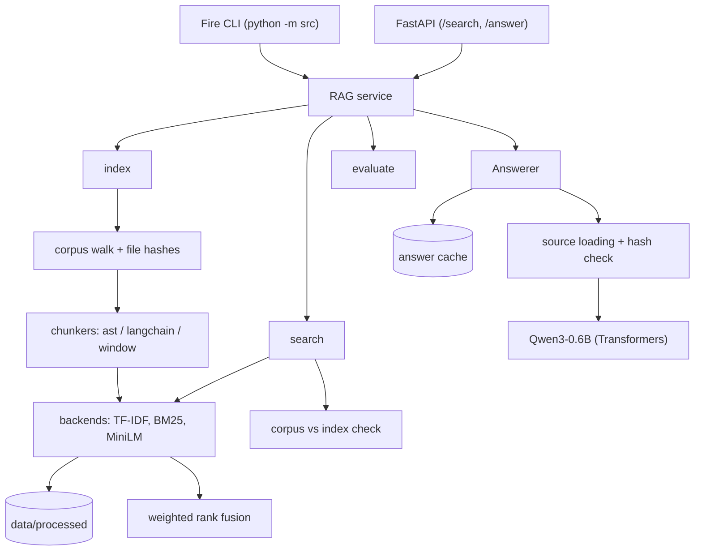

*This project has been created as part of the 42 curriculum by vquetier.*

# RAG against the machine

## Description

**RAG against the machine** is a Retrieval-Augmented Generation system that answers questions about a codebase (the vLLM 0.10.1 repository provided with the subject). It:

1. **indexes** the corpus: files are split into chunks of at most 2000 characters and stored in persistent indexes under `data/processed/`;
2. **retrieves** the most relevant chunks for a question, as source locations (`file_path`, `first_character_index`, `last_character_index`);
3. **generates** a grounded answer from those chunks with a small local model (`Qwen/Qwen3-0.6B`);
4. **evaluates** retrieval quality with recall@k against a ground-truth dataset.

Main features: AST-aware chunking for Python and structure-aware splitting for Markdown and text, three retrieval backends (TF-IDF, BM25, MiniLM embeddings) combined by weighted rank fusion, incremental indexing, search and answer caches, a Python Fire CLI and a small local HTTP API.

## Instructions

### Requirements

- Python 3.10 to 3.13 and [uv](https://docs.astral.sh/uv/).
- `git` and network access for the first `uv sync` and the first download of the models from the Hugging Face Hub.
- Several gigabytes of free disk space. A GPU is optional: models run on CUDA when available, on CPU otherwise.

### Installation

```bash
git clone <repository-url> rag
cd rag
make install        # runs: uv sync
```

The data layout is the one of the subject (`data/` is ignored by Git):

```text
data/
├── raw/                  # corpus to index (e.g. data/raw/vllm-0.10.1/...)
├── datasets/             # UnansweredQuestions/ and AnsweredQuestions/
├── processed/            # indexes and caches (generated)
└── output/               # search results and answers (generated)
```

### Makefile

| Target | Action |
|---|---|
| `make install` | Install the dependencies with `uv sync`. |
| `make run ARGS="..."` | Run the CLI: `uv run python -m src $(ARGS)`. |
| `make debug ARGS="..."` | Run the CLI under `pdb`. |
| `make index`, `search`, `search_dataset`, `answer`, `answer_dataset`, `evaluate` | Shortcut for the CLI command; options go in `ARGS`. |
| `make serve` / `make client` | Start the HTTP API on `127.0.0.1:8000` / open its Swagger UI. |
| `make lint` / `make lint-strict` | `flake8 .` and `mypy .` with the flags of the subject / with `--strict`. |
| `make clean` | Remove Python and tool caches. |
| `make dclean` | **Destructive**: delete the generated indexes, caches and outputs under `data/`. |
| `make fclean` / `make re` | `clean` and delete `.venv` / then reinstall. |

### Configuration

Every command accepts `--config_file=<name>`, a file of the `config/` directory (default: `default.yaml`). Each configuration keeps its indexes in its own directory.

| File | Indexed file types | Backends (fusion weights) |
|---|---|---|
| `default.yaml` | `.py`, `.md`, `.txt` | TF-IDF 0.15, BM25 1.0, MiniLM 0.3 |
| `docs.yaml` | `.md`, `.txt` | TF-IDF 0.1, BM25 1.0, MiniLM 0.1 |
| `code.yaml` | `.py` (without `tests`, `examples`) | BM25 1.0, MiniLM 0.3 |
| `fast.yaml` | `.py`, `.md`, `.txt` | BM25 only, no embedding model |

A configuration file sets the corpus and index directories, the excluded directory names, the chunking method of each file type (`ast`, `langchain` or `window`), the enabled backends and their weights, the k values and IoU threshold of `evaluate`, and the generation settings (model, thinking mode, temperature, token limits, optional preprompt). It is validated with pydantic, and errors are reported as a readable list.

## Example usage

Every command is run as `uv run python -m src <command> [options]`.

```bash
# 1. Index the corpus (incremental on later runs); --max_chunk_size is 200 to 2000, default 2000
uv run python -m src index --max_chunk_size 2000

# 2. Search one query (prints "<file_path> [<first>:<last>]", best first)
uv run python -m src search "How do I load a LoRA adapter?" --k 5

# 3. Search a whole dataset -> <save_directory>/<dataset file name>
uv run python -m src search_dataset \
  --dataset_path data/datasets/UnansweredQuestions/dataset_docs_public.json \
  --k 10 \
  --save_directory data/output/search_results/UnansweredQuestions

# 4. Answer one query (rendered as Markdown in the terminal)
uv run python -m src answer "How do I load a LoRA adapter?" --k 5

# 5. Answer a search results file -> <save_directory>/<input file name>
uv run python -m src answer_dataset \
  --student_search_results_path data/output/search_results/UnansweredQuestions/dataset_docs_public.json \
  --save_directory data/output/search_results_and_answer/UnansweredQuestions

# 6. Recall@k of search results against the ground truth
uv run python -m src evaluate \
  --student_search_results_path data/output/search_results/UnansweredQuestions/dataset_docs_public.json \
  --dataset_path data/datasets/AnsweredQuestions/dataset_docs_public.json
```

Output files follow the `StudentSearchResults` and `StudentSearchResultsAndAnswer` models of the subject; each source carries one extra field, `chunk_hash`:

```json
{
  "search_results": [
    {
      "question_id": "q1",
      "question": "How to configure OpenAI server?",
      "retrieved_sources": [
        {
          "file_path": "data/raw/vllm-0.10.1/docs/serving/openai_compatible_server.md",
          "first_character_index": 9867,
          "last_character_index": 10100,
          "chunk_hash": "<sha256 of the chunk text>"
        }
      ]
    }
  ],
  "k": 10
}
```

Degenerate inputs (empty query, `k <= 0`, missing file, malformed JSON, invalid configuration) produce a one-line message and a non-zero exit status, or an empty result, never a traceback.

The HTTP API exposes the same search and answer functions:

```bash
make serve
curl -X POST http://127.0.0.1:8000/search \
  -H "Content-Type: application/json" \
  -d '{"query": "How do I load a LoRA adapter?", "k": 3}'
```

`POST /answer` takes the same body. Interactive documentation is served at `/docs`.

## System architecture



| Module | Responsibility |
|---|---|
| `src/__main__.py`, `src/rag/rag_cli.py` | Entry point and Fire commands: argument validation, error reporting. |
| `src/rag/rag_http_api.py` | FastAPI application exposing search and answer. |
| `src/rag/rag.py` | `RAG`: orchestration shared by the CLI and the API. |
| `src/rag/config/`, `src/rag/data_models/` | Pydantic models of the configuration and of the subject's data structures. |
| `src/rag/retrieval/` | Corpus walk, chunkers, backends, indexing loop, rank fusion, corpus/index check. |
| `src/rag/generation/` | Prompt construction, answer cache, local LLM and token budgets. |
| `src/rag/evaluation/`, `src/rag/dataset/` | Recall@k and IoU; JSON loading and writing. |

1. **Indexing.** The corpus is walked, each file is hashed, and only the files a backend does not already hold in their current version are chunked. Each chunk is stored with the SHA-256 of its text.
2. **Retrieval.** Each enabled backend ranks its best chunks for the query; the rankings are fused into one list of source locations.
3. **Augmentation.** The text of each retrieved source is read back from the corpus and verified against its hash before being placed in the prompt.
4. **Generation.** The prompt is checked against the token budgets, the model generates, and the final answer is extracted and cached.

## Chunking strategy

A chunk is a file path and a range of **character** indices in the decoded file. Code and prose are split differently because their natural units differ.

**Python: AST-aware chunking.** The file is parsed with the `ast` module. A range that fits in `max_chunk_size` is kept whole; otherwise it is divided at the ends of its child statements, recursively (a class into its methods, a method into its blocks). Decorators, comments and blank lines stay attached to the definition that follows them, and small neighbouring chunks are merged while they fit. A range with no child structure left (a huge literal) is split along line boundaries. Chunks are contiguous, never overlap and cover the whole file. Since `ast` reports columns as UTF-8 byte offsets, they are converted to character indices. A file that cannot be parsed falls back to the text splitter.

**Markdown and text: recursive splitting.** LangChain's `RecursiveCharacterTextSplitter` is used with Markdown separators (headings, code fences, paragraphs) for `.md` and the default separators for `.txt`. It tries the coarsest separator first, so chunks follow the document structure where possible. Consecutive chunks overlap by up to 100 characters.

**Chunk size.** `--max_chunk_size` defaults to 2000, the maximum allowed by the subject, and is never exceeded. With 2000, the corpus gives 13,867 chunks for 1,847 files.

## Retrieval method

| Backend | Kind | Engine | Scoring |
|---|---|---|---|
| `tfidf` | lexical | [Xapian](https://xapian.org/) | TF-IDF |
| `bm25` | lexical | [Tantivy](https://github.com/quickwit-oss/tantivy) | BM25 |
| `minilm` | semantic | `all-MiniLM-L6-v2` + [Chroma](https://www.trychroma.com/) | cosine distance |

Each chunk is indexed as its text prefixed with the path of its file, so that a question naming a file or a module can match it. Questions are treated as plain text, not as query syntax: boolean operators are disabled in Xapian, and the BM25 query is built from the analyzed tokens of the question. On CPU, the embedding model runs through its quantized OpenVINO export.

**Weighted rank fusion.** Raw scores of different backends are not comparable, so only ranks are combined:

1. each enabled backend returns its `K = max(50, 2k)` best chunks;
2. a chunk of rank `r` in a backend of weight `w` receives `w * (K - r + 1) / K` (equal raw scores share a rank);
3. the scores a chunk receives from several backends are added;
4. the `k` chunks with the highest totals are returned, best first.

## Performance analysis

Measurements were made on an Intel Core Ultra 7 265 (20 logical CPUs) with the GPU hidden, so they reflect a CPU-only machine. Recall is computed by `evaluate`, which implements the metric of the subject (same file, IoU of at least 0.05).

### Recall@k

Public datasets, `search_dataset --k 10`, `--max_chunk_size 2000`:

| Configuration | Dataset | Recall@1 | Recall@3 | Recall@5 | Recall@10 |
|---|---|---|---|---|---|
| `default.yaml` | docs (100 questions) | 54.00 % | 78.00 % | **87.00 %** | 90.00 % |
| `default.yaml` | code (99 questions) | 36.36 % | 60.61 % | **66.67 %** | 75.76 % |
| `docs.yaml` | docs | 70.00 % | 87.00 % | **92.00 %** | 95.00 % |
| `code.yaml` | code | 40.40 % | 59.60 % | **70.71 %** | 76.77 % |
| `fast.yaml` | docs | 61.00 % | 77.00 % | **84.00 %** | 86.00 % |
| `fast.yaml` | code | 36.36 % | 59.60 % | **65.66 %** | 70.71 % |

Every configuration is above the thresholds of the subject (80 % on docs, 50 % on code). The fusion weights were chosen by a grid search on these public datasets, preferring settings whose neighbours score similarly; they are fitted to about 100 questions per dataset, so the same margins are not guaranteed on other questions. BM25 carries most of the signal on this corpus.

### Effect of the chunk size

`default.yaml`, whole index rebuilt for each value of `--max_chunk_size`:

| `--max_chunk_size` | Chunks | Indexing time | Docs Recall@5 | Code Recall@5 |
|---|---|---|---|---|
| 500 | 53,524 | 4 min 22 s | 83.00 % | 73.74 % |
| 1000 | 27,079 | 2 min 39 s | 88.00 % | 64.65 % |
| 1500 | 18,279 | 1 min 56 s | 85.00 % | 70.71 % |
| 2000 (default) | 13,867 | 1 min 43 s | 87.00 % | 66.67 % |

Docs recall stays within a few points for every size. Code recall tends to improve with smaller chunks, which isolate individual functions better, but not monotonically, and the fusion weights were tuned at 2000 only. The cost is indexing time: the number of chunks to embed grows as the size shrinks, and at 500 indexing comes close to the 5-minute limit on CPU.

### Speed

| Operation | Configuration | Time |
|---|---|---|
| Indexing from scratch (1,847 files) | `default.yaml` | 1 min 43 s |
| Indexing from scratch (915 files) | `code.yaml` | 1 min 02 s |
| Indexing from scratch (206 files) | `docs.yaml` | 11 s |
| Indexing from scratch (1,847 files) | `fast.yaml` | 2.5 s |
| `search_dataset`, 100 docs questions, empty cache | `default.yaml` | 9.2 s |
| `search_dataset`, 99 code questions, empty cache | `default.yaml` | 9.2 s |

Indexing the whole corpus fits in the 5-minute limit on CPU, and about 200 questions are searched in under 20 seconds against a limit of 90. Embedding the chunks dominates indexing time. Repeated searches are served by the search cache in about one second per dataset.

## Design decisions

- **AST chunking for code, separator-based splitting for prose.** Code questions refer to functions and classes, documentation to sections; each chunker follows the structure of its file type while guaranteeing the size limit.
- **Several backends behind one interface.** Lexical and semantic engines can be enabled, weighted and compared from the configuration alone.
- **Rank fusion rather than score fusion.** Ranks are comparable across engines without any normalisation.
- **File path indexed with each chunk.** Many questions name a file or a component; this was the single largest gain on code questions.
- **Persistent, incremental indexes.** Each backend keeps a manifest of file hashes and a copy of the configuration it was built with, so a new run only processes added, modified and removed files.
- **No automatic deletion.** An interrupted indexing run leaves a `.indexing` marker; the index is then refused with a message naming the directory to delete, instead of removing user-configured directories automatically. An index that is merely out of date stays searchable, with a warning.
- **Chunk hashes.** A source is verified against the hash of its indexed text before being given to the model, so an answer is never generated from text that changed since retrieval.
- **Caches.** Raw engine hits are cached per backend and per indexed snapshot; answers are cached by question, source hashes and generation settings.
- **Explicit token budgets.** A prompt that exceeds the configured limit or the model context window is an error with measured sizes, not a silent truncation.
- **Lazy loading.** Models are loaded only by the commands that need them.

## Challenges faced

- **Character indices from the AST.** `ast` columns are byte offsets, which shifts every chunk located after a non-ASCII character. *Solution:* per-line conversion by decoding the byte prefix.
- **Oversized syntactic units.** Some functions and literals exceed 2000 characters. *Solution:* recursive descent, greedy merging and a line-based fallback.
- **Questions are not search queries.** Words such as `AND` or `NOT` and punctuation were interpreted as operators by the search engines. *Solution:* operators disabled in Xapian, token-based query for BM25.
- **Incomparable backend scores.** *Solution:* weighted rank fusion.
- **Embedding time on CPU.** PyTorch on CPU took about 20 minutes for the corpus during development. *Solution:* the quantized OpenVINO export of MiniLM, batching and incremental indexing.
- **Interrupted runs.** Three independent engines cannot be committed atomically. *Solution:* a per-backend marker removed only after the final commit.
- **A small reasoning model.** Qwen3-0.6B can spend its whole output budget thinking. *Solution:* configurable thinking mode and output limit, removal of the thinking part, detection of unfinished thinking.
- **Command-line parsing.** Python Fire converts values that look like Python literals. *Solution:* text arguments are declared as strings and integers are validated explicitly.

## Bonus features

| Bonus | Implementation |
|---|---|
| Semantic embeddings | `minilm` backend: `all-MiniLM-L6-v2` and a persistent Chroma vector index. |
| Hybrid retrieval | Weighted rank fusion of the lexical and semantic rankings. |
| Incremental indexing | Per-file hashes: only added, modified and removed files are processed. |
| Caching | Persistent indexes, per-backend search cache, answer cache. |
| Local HTTP API | FastAPI server with `POST /search` and `POST /answer` (`make serve`). |

## Resources

### References

- Lewis et al., [Retrieval-Augmented Generation for Knowledge-Intensive NLP Tasks](https://arxiv.org/abs/2005.11401) (2020).
- Robertson and Zaragoza, [The Probabilistic Relevance Framework: BM25 and Beyond](https://doi.org/10.1561/1500000019) (2009).
- Manning, Raghavan and Schütze, [Introduction to Information Retrieval](https://nlp.stanford.edu/IR-book/).
- Cormack, Clarke and Büttcher, [Reciprocal Rank Fusion](https://doi.org/10.1145/1571941.1572114) (2009).
- Reimers and Gurevych, [Sentence-BERT](https://arxiv.org/abs/1908.10084) (2019); [all-MiniLM-L6-v2](https://huggingface.co/sentence-transformers/all-MiniLM-L6-v2) and [Qwen3-0.6B](https://huggingface.co/Qwen/Qwen3-0.6B) model cards.
- Documentation of [Xapian](https://xapian.org/docs/), [tantivy-py](https://github.com/quickwit-oss/tantivy-py), [Chroma](https://docs.trychroma.com/), [Sentence Transformers](https://sbert.net/), [Transformers](https://huggingface.co/docs/transformers/index), [LangChain text splitters](https://github.com/langchain-ai/langchain/tree/master/libs/text-splitters), [Python `ast`](https://docs.python.org/3/library/ast.html), [Python Fire](https://github.com/google/python-fire), [pydantic](https://docs.pydantic.dev/), [FastAPI](https://fastapi.tiangolo.com/) and [diskcache](https://grantjenks.com/docs/diskcache/).

### AI usage

- **Documentation.** The docstrings of the code base and the first version of this README were written with Claude Code from the existing implementation.
- **Review.** Claude Code and Chat GPT were used to review each PRs and to do a final review for a 100% subject compliance.
- **Research.** Chat GPT was used to find useful libs, documentation of those libs, etc.
- **Terminal output.** Claude Code was used to improve terminal output lisibility (small implementations in logger.py)

Every AI-Generated code is flagged in the PR's description.
